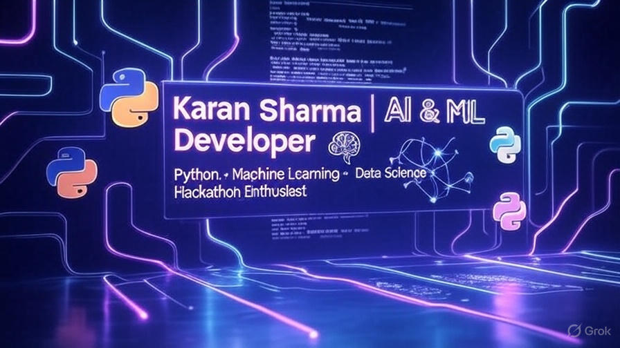

<!-- ================= BANNER ================= -->
<!-- Add a 1200x300px banner.jpg to your profile repo root, then uncomment: -->
<!-- 

 -->

# Karan Sharma
### AI/ML Engineer · Generative AI & RAG Systems

<a href="#about-me">About</a> ·
<a href="#core-expertise">Expertise</a> ·
<a href="#featured-projects">Projects</a> ·
<a href="#tech-stack">Tech Stack</a> ·
<a href="#github-analytics">Analytics</a> ·
<a href="#connect-with-me">Connect</a>

 

## About Me

Final-year B.Tech (AI/ML) student focused on building real backend AI systems — retrieval that's accurate, APIs that are testable, code structured for actual use.

Proved this during my internship at **ALIMCO**, a Government of India PSU, building an enterprise RAG chatbot end-to-end.

**Background:** Diploma in Electronics Engineering (SBTE Bihar, 2022–2025) → B.Tech CSE (AI/ML), CGC Jhanjeri.

 

## Current Focus

- 🔧 Refining backend AI systems and RAG pipelines
- 📚 Deepening LLM engineering and prompt design
- 🧩 Exploring agentic AI workflows
- 🎓 Completing my B.Tech (AI/ML) — final year

 

## Core Expertise

`Artificial Intelligence` `Machine Learning` `Generative AI` `RAG Systems`
`LLMs` `Prompt Engineering` `FastAPI Backends`

 

---

## Experience

**AI Intern — ALIMCO**
*Artificial Limbs Manufacturing Corporation of India · Government of India PSU*

- Built an enterprise **RAG chatbot** for semantic search & Q&A over assistive-device documentation
- Designed a modular **FastAPI backend** — loader → chunker → embedder → vector store → retriever → prompt → LLM
- Implemented semantic search with **Sentence Transformers (BAAI/bge-base-en-v1.5)** + **ChromaDB**
- Integrated dual LLM paths: **Gemini API** (cloud) and **Ollama** (local)
- Tested end-to-end via **FastAPI Swagger UI** — evaluated Easy 20/20, Medium 27/30, Hard 9/10, Expert 9/10

---

 

## Featured Projects

### ⭐ ALIMCO RAG Chatbot
  

Enterprise RAG chatbot enabling semantic search and Q&A over assistive-device documentation. Backend-only, tested end-to-end via Swagger UI.
